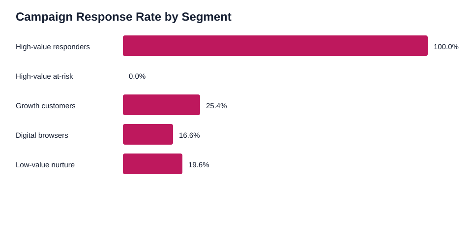
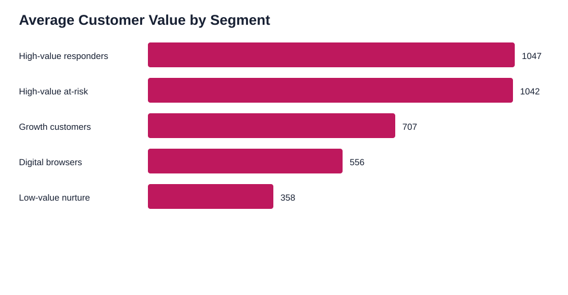

# Customer Personality Marketing Analytics

Marketing Data Analyst portfolio project using Kaggle's **Customer Personality Analysis** dataset to analyse customer value, campaign response, product preferences, segmentation, and targeting opportunities.

Dataset source: [Customer Personality Analysis on Kaggle](https://www.kaggle.com/datasets/imakash3011/customer-personality-analysis)

## Business Problem

Marketing teams need to understand which customers respond to campaigns, which products drive revenue, and which customer segments should receive targeted offers. This project converts customer-level transaction and campaign data into actionable marketing recommendations.

## Executive Summary

This project answers four core marketing questions:

- Which customer segments generate the most revenue?
- Which customers are most likely to respond to campaigns?
- Which product categories drive spend by segment?
- Which targeting actions should marketing teams prioritise?

## Key Results

| Customer Segment | Customers | Response Rate | Avg Customer Value | Total Customer Value | Recommended Action |
| --- | ---: | ---: | ---: | ---: | --- |
| High-value responders | 76 | 100.0% | GBP1,047 | GBP79,578 | Premium loyalty and cross-sell |
| High-value at-risk | 83 | 0.0% | GBP1,042 | GBP86,503 | Win-back offer |
| Growth customers | 1,151 | 25.4% | GBP707 | GBP813,562 | Product bundle recommendation |
| Digital browsers | 253 | 16.6% | GBP556 | GBP140,666 | Digital conversion campaign |
| Low-value nurture | 637 | 19.6% | GBP358 | GBP228,113 | Monitor |

The analysis identifies a clear targeting strategy: protect high-value at-risk customers, cross-sell to proven responders, and convert digital browsers who show web activity but lower purchase conversion.

## Dashboard Preview





## Repository Structure

```text
data/
  raw/
    marketing_campaign.csv
  processed/
    customers_marketing_scored.csv
    segment_summary.csv
    campaign_response_summary.csv
    product_category_summary.csv
    targeting_recommendations.csv
dashboard/
  screenshots/
docs/
  kaggle_download_instructions.md
  data_dictionary.md
  marketing_recommendations.md
  dashboard_requirements.md
  portfolio_scorecard.md
sql/
  marketing_analysis_queries.sql
src/
  generate_demo_data.py
  build_marketing_analysis.py
```

## Tools Used

- Python: pandas and numpy
- SQL: segmentation, campaign response, product spend analysis
- Dashboarding: Power BI/Tableau-ready summaries and SVG previews
- Business analysis: stakeholder questions, KPI definitions, marketing recommendations

## Key KPIs

- Campaign response rate
- Average customer value
- Total product spend
- Recency
- Web purchase share
- Store purchase share
- High-value customer count
- Recommended targeting action

## How To Run

Option 1: Use Kaggle data.

1. Download the dataset from Kaggle.
2. Place `marketing_campaign.csv` in `data/raw/`.
3. Run:

```powershell
python src/build_marketing_analysis.py
```

Option 2: Run immediately with demo data.

```powershell
python src/generate_demo_data.py
python src/build_marketing_analysis.py
```

## Data Privacy

The Kaggle dataset is public. The demo data generated in this repo is synthetic and for portfolio demonstration only.

## Suggested GitHub Topics

`marketing-analytics`, `data-analysis`, `customer-segmentation`, `campaign-analysis`, `sql`, `python`, `power-bi`, `kaggle`, `business-analysis`
